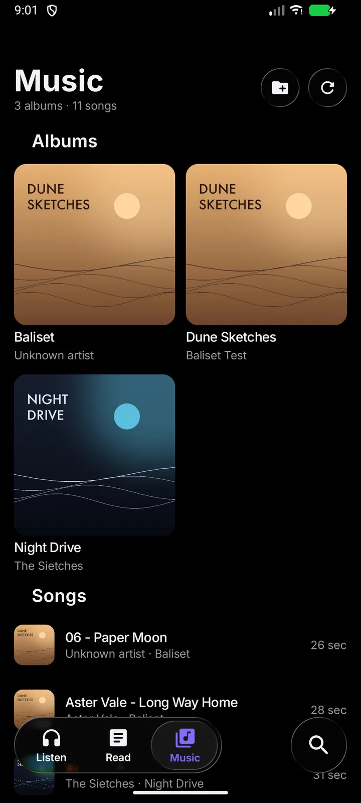
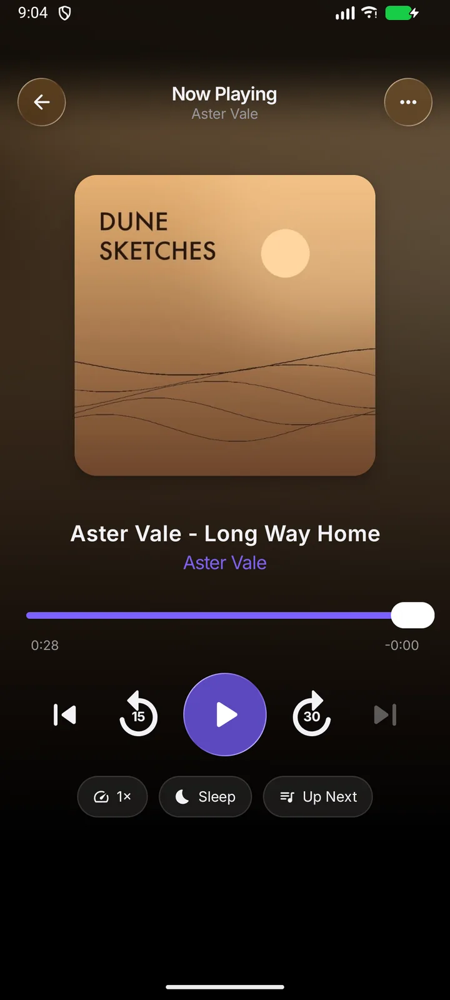
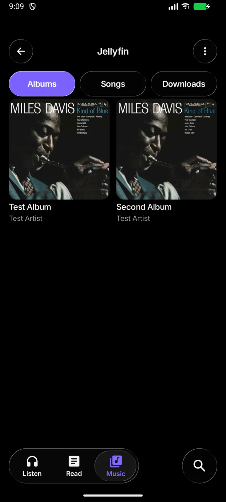

# Thumper

A podcast player, feed reader and music player for Android, with iOS-style liquid glass, in the same minimal style as
[Seekur](https://github.com/everettpenne/DuneDdit) and [Spice](https://github.com/everettpenne/Spice). Three libraries — podcasts,
reading and music — and one player for all of them.

- **Listen:** Continue Listening, your shows, and the newest episodes across them. Pull to refresh.
- **Read:** your blogs and news feeds as one list, newest first, with unread dots, filter by feed, and a clean reader with links, lists and pictures.
- **Search:** find podcasts in [Apple's directory](https://performance-partners.apple.com/search-api) (no sign-up) or in [Podcast Index](https://podcastindex.org/) (open and independent; needs a free key and secret), or paste any feed's address, or a blog's home page: Thumper finds its feed.
- **Player:** background listening with a notification, skip back and forward (you choose the seconds), speed from 0.8× to 3×, a sleep timer (minutes or end of episode), and it remembers where you were in every episode.
- **Up Next:** queue episodes from any episode's ••• menu (Play Next, or add to the end), reorder them, and the next one starts by itself when one ends, even with the app closed. The notification's and a headset's "next" skip to it.
- **Downloads:** save episodes to listen without a connection, from the ••• menu or an episode's page. Optionally Wi-Fi only, delete after playing, and per-show "Download New Episodes". A Downloads screen shows what is coming down, what is on the phone and how much space it takes. Downloaded episodes play from the file, with no network at all.
- **Music:** a Music tab for the songs on the phone (including AIFF/Apple Music libraries) and, optionally, a Jellyfin server. Albums,
  songs, artwork, a shared Up Next and downloads; Jellyfin streams and downloads the original files with the token in an Authorization
  header, never in a URL. The same Now Playing screen, mini player, notification and lock screen serve podcasts and music.
- **Playlists and favourites:** make lists, rename or delete them, add songs from the hold sheet, and keep favourites. They use the
  same one player and queue. A Library Check reports missing files, unplayable formats, duplicates, missing covers and untagged songs.
- **Crossfade and leveling:** music can overlap by 3–12 seconds and use a measured volume correction; podcasts keep their own speed,
  skip buttons and sleep timer. Crossfade is off by default.
- **Yours:** subscriptions live on the phone. Import and export them as OPML, which every other podcast app and feed reader understands.

<p align="center">
  
  
  
</p>

Not yet: chapters, background refresh with new-episode notifications, drag-to-reorder in Up Next (it has Move Up/Down/Top today), Android Auto,
MusicBrainz cover lookup. A Jellyfin server is optional and only the first music library on it is shown.

## Where your data goes

Nowhere, except where you point it. There is no account, no analytics and no server of ours. Searching sends your search words to the directory you chose (Apple or Podcast Index). Subscribing and refreshing fetch each show's or site's own feed directly from its publisher, and playing streams the episode from the publisher's host. Subscriptions, listening positions, read marks and the music library index are plain JSON files in the app's private storage; the Podcast Index key and secret are kept encrypted (Android Keystore). The Jellyfin address, username and token are kept encrypted with a keystore key, and downloads live in the app's own storage. A Jellyfin server at home is usually plain http; the sign-in screen warns when the address is not https.

## Build

The liquid-glass UI kit (components, theme, type scale) is the separate `Glass` project, pulled in with a Gradle `includeBuild("../Glass")`, so it must be checked out next to this folder.

```bash
./gradlew :app:assembleDebug      # JDK 21, Android SDK (compileSdk 36); minSdk 31
./gradlew :app:testDebugUnitTest  # JVM tests: the feed parser, HTML reader, fetcher, directories, OPML, library, the shared queue
```

Music is scanned from Android's media index or a folder you choose with the system picker; AIFF is read by the app's own extractor because
Android and Media3 do not support it. Jellyfin is optional: the Music tab's server button signs in, and downloaded albums play with the
server off.

Release signing comes from the environment (`THUMPER_RELEASE_STORE_FILE`, `_STORE_PASSWORD`, `_KEY_ALIAS`, `_KEY_PASSWORD`); without all four the release build is left unsigned.

## Trying it without the internet

`tools/fake-feeds/server.py` is a stand-in for the outside world (needs ffmpeg and Pillow once): Apple-shaped search and charts, a podcast feed with a real MP3, an Atom blog, and a web page that advertises its feed.

```bash
python3 tools/fake-feeds/server.py      # serves on :8097
adb reverse tcp:8097 tcp:8097           # the emulator then reaches it at http://localhost:8097
```

(`localhost` rather than the emulator's usual `10.0.2.2`: Android's DownloadManager is a separate system process that can't reach `10.0.2.2`.)

`FlowAgainstFakeFeedsTest` (instrumented) drives it: find a show, subscribe, listen, background playback and resuming, Up Next playing in order and advancing by itself, reordering, downloading an episode and playing it with no network, adding a blog by its web address, reading it, and Settings. `RealNetworkTest` does the same against Apple's real directory and a real show, and needs the emulator to have internet.

## Credits

Liquid glass by [Backdrop](https://github.com/Kyant0/AndroidLiquidGlass) (Apache-2.0); type is [Inter](https://github.com/rsms/inter) (SIL OFL 1.1, `docs/licenses/Inter-OFL.txt`) set to Apple's HIG scale; playback by AndroidX Media3; images by Coil. MIT licensed, see `LICENSE`.

## Building with Glass

The shared UI kit lives in its own repository, [Glass](https://github.com/everettpenne/Glass), checked out next to this one (`../Glass`) and built
with it through `includeBuild`. `glass.version` names the Glass tag this app is built and released with; CI checks out exactly that tag. To
build locally, check Glass out beside this repository at that tag (`git -C ../Glass checkout $(cat glass.version)`).


## Status

Version 1.0.0 folds the Baliset music player into Thumper: local music and AIFF, playlists/favourites, the library check, Jellyfin
streaming and downloads, crossfade and leveling. 115 JVM tests; R8 build exercised; Jellyfin tested against a local mock server.
